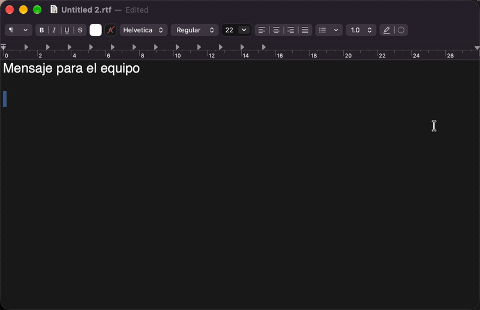

# TypeLang

A tiny menu-bar app for macOS that turns what you type **or say** — anywhere — into natural, professional English (or whatever language pair you set), or cleans up your dictation in your own language, without leaving the app you're working in.

Press a global keyboard shortcut, a small floating window appears wherever your cursor is, type in your language, hit Enter — the natural translation is pasted directly into the field you were writing in. Or hold the dictation shortcut and just talk: when you let go, the translation (or your own words, cleaned up) lands at your cursor. No copy-pasting into a browser tab, no breaking your flow.


> **New in 0.2.1:** dictate in Spanish and keep it in Spanish — an **Improve** mode cleans up your dictation without translating it, and a chip on the recording pill switches between translating (`ES→EN`) and keeping your language (`ES`). See the [CHANGELOG](CHANGELOG.md).
>
> **New in 0.2.0:** voice dictation (🎤 in the popup, or hold `Alt+Shift+D` anywhere), custom vocabulary, snippets, optional autostart of local AI servers, and a fix for the paste that sometimes typed a single letter instead of the translation. Upgrading from 0.1.0? See the [upgrade notes](CHANGELOG.md#upgrading-from-010) — you'll need to re-grant Accessibility once. Full list in the [CHANGELOG](CHANGELOG.md).

## Why

Non-literal translation. If you speak, say, Spanish and work with English-speaking colleagues, tools like Google Translate produce stiff, word-for-word English. TypeLang sends your text to an LLM (Claude, GPT, Gemini, or a local model through any OpenAI-compatible server such as LM Studio or llama.cpp) with a prompt tuned for natural, idiomatic, professional phrasing — the way a fluent bilingual coworker would actually write it.

You can also **speak** instead of type: dictate in your language and get polished English pasted where your cursor is — or keep it in your language, just cleaned up — like Wispr Flow, but running entirely on your own machine if you want it to.

## Features

- **Global shortcut, configurable** — record any key combination in Settings; defaults to something unlikely to collide with your browser's shortcuts.
- **Bring your own API key (BYOK)** — plug in Anthropic, OpenAI, Google Gemini, or point it at any local OpenAI-compatible server ([LM Studio](https://lmstudio.ai), [llama.cpp](https://github.com/ggml-org/llama.cpp)'s `llama-server`, …). No account, no subscription, no data going through a third-party server you don't control.
- **Voice dictation** — click the 🎤 in the popup, speak, click again: the transcript appears in the popup so you can review it, then Enter translates it. Filler words ("eh", "o sea"…) and self-corrections ("el martes, no perdón, el miércoles") are cleaned up in the translation.
- **Hold-to-talk shortcut** — hold the dictation shortcut (default `Alt+Shift+D`), speak, release: the result is pasted straight at your cursor, no popup. **Double-tap** it instead to keep recording hands-free, and press it once more to finish. A small floating pill at the bottom of the screen shows the timer, with ✓ to finish and paste and ✕ to discard; it never takes focus from the app you are typing in. Recordings stop on their own after 5 minutes. Settings → Dictation sets what it pastes: the **translation**, or your words **kept in the language you spoke** — either **improved** (punctuation, capitalization, transcription mistakes and filler words fixed, your words kept; if the model fails or answers instead of editing, it pastes your original words and the pill says so) or the **original** transcript as is. The pill has a chip next to the timer (`ES→EN` while translating, `ES` while keeping your language); click it to switch between the two, even mid-recording — it is the same setting as in Settings. Whether keeping the language means improved or original is chosen in Settings only. The menu-bar icon shows `●` while recording, `…` while processing and `⚠` on errors (hover it for details).

  
- **Custom vocabulary** — product names, people, jargon: listed once in Settings, spelled right in both the transcript and the translation.
- **Snippets** — press ⌘Enter instead of Enter to save a translation as a snippet; a second shortcut (default `Alt+Shift+S`) opens a searchable picker to paste it again without re-translating.
- **Start local services automatically** — optionally run a command when TypeLang opens (e.g. a script that starts your local speech-to-text and LLM servers) and stop it when TypeLang quits. If the services are already running, TypeLang leaves them alone.
- **Configurable translation direction** — pick source/target languages from Settings, not hardcoded to one pair.
- **Bilingual interface** — Spanish and English UI, switchable in Settings.
- **Auto-paste, not copy-paste** — the translation lands directly in the field you were typing in, with your original clipboard contents restored afterward.
- **Quick tone toggle** — switch between professional and casual right from the tray menu (sets the default) or per-message from the popup itself (Tab, or click the tone badge for a dropdown) — handy for jumping between work chats and personal messages without opening Settings.
- **Menu-bar only** — no Dock icon, stays out of the way until you need it.


## Status

Early, actively developed, **macOS only** for now (Windows/Linux support is on the roadmap — the paste/focus-capture logic is platform-specific and hasn't been ported yet). Expect rough edges.

## Installing the built app

Download `TypeLang-<version>-macOS.zip` from the [latest release](https://github.com/lickybuay/TypeLang/releases/latest), unzip it and drag `TypeLang.app` into `/Applications`. Or build it yourself with `npm run tauri build` (see below) and drag `src-tauri/target/release/bundle/macos/TypeLang.app` there.

This project doesn't (and won't) pay for an Apple Developer ID certificate — it's free and open source, and that costs $99/year for something that only silences a warning. Because the app isn't signed, **macOS Gatekeeper will refuse to open it on the first launch** with a message like "TypeLang can't be opened because Apple cannot check it for malicious software" or "...is from an unidentified developer." This is expected, not a bug. Pick one:

1. **Right-click (or Control-click) the app → Open**, instead of double-clicking. A dialog appears with an actual "Open" button this time — click it. You only need to do this once; it launches normally from then on.
2. **System Settings → Privacy & Security**, scroll down — you'll see "TypeLang was blocked to protect your Mac" with an **Open Anyway** button.
3. **Terminal, for repeat installs/updates:**
   ```sh
   xattr -d com.apple.quarantine /Applications/TypeLang.app
   ```
   This removes the quarantine flag that triggers the Gatekeeper check in the first place.

## Usage

Applies whether you're running the built `.app` or `npm run tauri dev` — the app is menu-bar only, so look for its icon next to the clock.

1. **First launch:** macOS will ask for **Accessibility** permission — this is required to simulate the paste keystroke. Grant it in System Settings → Privacy & Security → Accessibility (you'll be prompted automatically the first time you try to translate something if you haven't granted it yet).
2. **Configure a provider:** click the menu-bar icon → **Configuración/Settings** → pick a provider (Anthropic, OpenAI, Google Gemini, or **Local LLM** — any OpenAI-compatible server such as llama.cpp's `llama-server` or LM Studio) → paste in an API key (Local LLM doesn't need one — just its server URL, e.g. `http://127.0.0.1:8091/v1` for the llama.cpp setup below, or `http://localhost:1234/v1` for LM Studio) → save.
3. **Optional settings:** interface language, translation direction (which language you type in → which it translates to), and the global keyboard shortcut — click the shortcut field and press a new combination to change it.
4. **Translate:** place your cursor in any text field, press the shortcut (default `Alt+Shift+T`), type in your source language, press **Enter**. The popup closes and the translation is pasted automatically where your cursor was. Press **Escape** to cancel without pasting anything. The ⚙️ icon in the popup jumps straight to Settings.
5. **Dictate:** in the popup, click 🎤, speak, click 🎤 again — review the transcript and press Enter. Or hold the dictation shortcut (default `Alt+Shift+D`) anywhere, speak, and release — or tap it twice quickly to keep recording hands-free and press it again to finish (the pill's ✓ finishes, its ✕ discards; a single quick tap is ignored). The pill's chip switches between translating (`ES→EN`) and keeping your language (`ES`); in Settings → Dictation, "When not translating" picks **Improve** (cleaned up) or **Original** (exact transcript). The first time, macOS asks for **Microphone** permission; the permission dialog takes focus and closes the popup, so just reopen it and try again. Escape cancels a recording in the popup; popup recordings stop on their own after 2 minutes, shortcut recordings after 5.

### Running everything locally

This is the setup the author uses every day: everything runs on your Mac, nothing leaves it. Dictation needs a speech-to-text server with an OpenAI-compatible `/v1/audio/transcriptions` endpoint; translation and the Improve mode need an LLM server with an OpenAI-compatible `/v1/chat/completions` endpoint. Here, [whisper.cpp](https://github.com/ggml-org/whisper.cpp) does the first and [llama.cpp](https://github.com/ggml-org/llama.cpp) the second, on Apple Silicon.

**1. Install the servers and download the two models** (~5.5 GB in total):

```sh
brew install whisper-cpp ffmpeg llama.cpp

mkdir -p ~/AI/models
# Speech-to-text: Whisper large-v3-turbo, 5-bit (~574 MB)
curl -L -o ~/AI/models/ggml-large-v3-turbo-q5_0.bin \
  https://huggingface.co/ggerganov/whisper.cpp/resolve/main/ggml-large-v3-turbo-q5_0.bin
# Translation / Improve: Gemma 4 E4B instruct, Q4_K_M (~5 GB)
curl -L -o ~/AI/models/gemma-4-E4B-it-Q4_K_M.gguf \
  https://huggingface.co/unsloth/gemma-4-E4B-it-GGUF/resolve/main/gemma-4-E4B-it-Q4_K_M.gguf
```

**2. A start script**, e.g. `~/typelang-servers.sh` (change `-l es` to the language you speak):

```sh
#!/bin/zsh
# --convert writes a temporary .wav in the current directory, and an app
# launches scripts from "/", which isn't writable: move somewhere that is.
mkdir -p ~/Library/Caches/typelang-stt && cd ~/Library/Caches/typelang-stt || exit 1

# Speech-to-text on :8178
whisper-server -m ~/AI/models/ggml-large-v3-turbo-q5_0.bin -l es \
  --host 127.0.0.1 --port 8178 \
  --inference-path /v1/audio/transcriptions --convert \
  >> ~/Library/Logs/typelang-stt.log 2>&1 &
trap 'kill $! 2>/dev/null' EXIT INT TERM

# Translation / Improve on :8091 — thinking disabled
llama-server -m ~/AI/models/gemma-4-E4B-it-Q4_K_M.gguf --alias gemma-4-e4b \
  --host 127.0.0.1 --port 8091 --jinja \
  --chat-template-kwargs '{"enable_thinking":false}' \
  --ctx-size 4096 --parallel 2 --n-gpu-layers 99
```

`--parallel 2` lets a dictation and a popup translation run at the same time instead of queuing. Thinking must be off on the server: TypeLang doesn't send reasoning flags, and a thinking model can spend its whole budget reasoning and return an empty answer.

**3. Point TypeLang at them** (menu-bar icon → Settings):

| Setting | Value |
|---|---|
| Translation provider | **Local LLM** |
| Server URL | `http://127.0.0.1:8091/v1` |
| Model | `gemma-4-e4b` |
| Dictation server URL | `http://127.0.0.1:8178/v1` |
| Local services → command | `zsh ~/typelang-servers.sh` (TypeLang starts it when it opens and stops it when it quits) |

On an M4 Max this gives ~0.5 s transcription and ~0.3 s translation or clean-up per sentence, and Gemma 4 E4B handled the tricky cases in our tests (who-does-what pronouns, mid-sentence self-corrections, questions and instructions that must not be answered in Improve mode) better than other small models we tried. If you point the dictation URL at another machine, Settings warns you that your voice will be sent there.

## Development

Requirements: [Rust](https://rustup.rs), Node.js, and on macOS, Xcode Command Line Tools.

```sh
npm install
npm run tauri dev
```

This runs the app with hot-reload (frontend changes apply instantly; Rust changes trigger an automatic rebuild). Same first-run Accessibility prompt and Settings flow as above.

To build the standalone `.app` described above instead of running in dev mode:

```sh
npm run tauri build
```

The built app lands at `src-tauri/target/release/bundle/macos/TypeLang.app`.

### Keeping permissions across rebuilds (local signing)

By default the app is ad-hoc signed, and macOS ties Accessibility, Microphone and Local Network permissions to the exact build — so every rebuild asks for them again. Signing with a self-signed certificate makes macOS recognise TypeLang by its bundle id + your certificate instead, and the permissions stick:

1. Keychain Access → Certificate Assistant → **Create a Certificate…** → name it e.g. `TypeLang Local Signing`, Identity Type **Self Signed Root**, Certificate Type **Code Signing**.
2. Build with that identity (no config change needed):
   ```sh
   APPLE_SIGNING_IDENTITY="TypeLang Local Signing" npm run tauri build
   ```

Signing with a real identity also turns on macOS's hardened runtime, which blocks the microphone unless the app declares it. `src-tauri/Entitlements.plist` (`com.apple.security.device.audio-input`) does that; keep it if you change the bundle config, or dictation will record silence.

This only helps on your own Mac; anyone else running the app still sees the "unidentified developer" warning.

### Tests

```sh
cd src-tauri && cargo test
```

## How it works

- **Rust/Tauri backend** — registers the global shortcuts, captures whichever app has focus (by bundle id), shows a floating popup window, calls the configured LLM provider, then restores focus and pastes. The paste is a single CoreGraphics ⌘V event with the Command flag set on the event itself, posted only after you've released your modifier keys — so it can't arrive as a bare "v". If TypeLang can't get back to the original app, it shows an error instead of pasting somewhere else, and it only restores your previous clipboard if nothing else was copied in the meantime.
- **Dictation** — the microphone is captured in Rust ([`cpal`](https://github.com/RustAudio/cpal)) on a dedicated thread, encoded as WAV in memory ([`hound`](https://github.com/ruuda/hound)) and sent to the speech-to-text server; TypeLang itself writes nothing to disk and doesn't log your words (whisper-server's `--convert` does write a temporary audio file in its working directory). Popup recordings are capped at 2 minutes and cancelled whenever the popup closes; shortcut recordings are capped at 5 minutes.
- **Improve mode** — the transcript goes to the same LLM with an editor prompt instead of the translator one: same language, light edit, wrapped in `<transcript>` tags with the rule that it is not addressed to the model (so a dictated question or instruction is cleaned up, not answered or obeyed). If the reply is empty, cut off, much longer than the input or starts like a chat answer, TypeLang pastes the raw transcript instead and says so on the pill.
- **Translation checks** — the translator prompt says the text is a message for someone else (questions and instructions in it are translated, never answered or obeyed) and, for dictated Spanish→English, carries a few self-correction examples. A reply that is empty, far longer than the input or talks about translating instead of being the translation is never pasted: the popup shows an error and keeps your text, and dictation copies the transcript to the clipboard instead.
- **Recording pill** — on macOS the pill is a non-activating `NSPanel` (via [`tauri-nspanel`](https://github.com/ahkohd/tauri-nspanel), which requires `macOSPrivateApi` in `tauri.conf.json`), so clicking it never takes focus from the app you're dictating into. The hold / double-tap logic is a pure state machine in `src-tauri/src/dictation_machine.rs`.
- **React/TypeScript frontend** — the Settings window, the floating translate popup and the recording pill, all built from the same Vite bundle and routed by URL hash.
- API keys live in the OS keychain (via the [`keyring`](https://github.com/hwchen/keyring-rs) crate), never in plain-text config. Gemini's key is sent in a request header, not the URL, so it can't leak into an error message.
- Settings are saved to `settings.json` one write at a time and atomically (temporary file + rename), so the pill's chip and the Settings window can't overwrite each other.

## License

MIT — see [LICENSE](./LICENSE).

## Contributing

This is a young, personal project — issues and PRs are welcome, but expect the architecture to shift as it matures.
